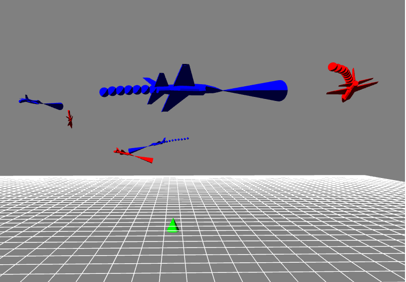
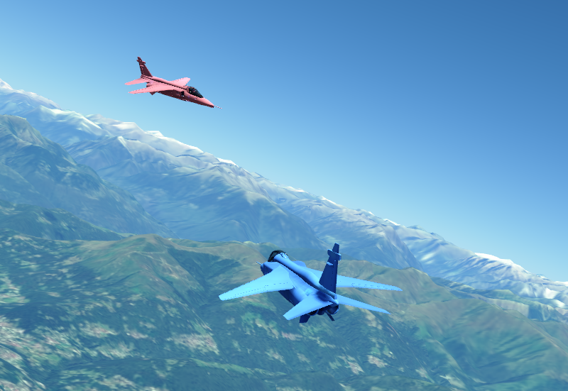

# Hierarchical Multi-Agent Reinforcement Learning for simulated Air Combat
3D Heterogeneous Hierarchical MARL for realistic Air Combat Simulation. This is the official implementation of [this paper](https://arxiv.org/pdf/2510.11474). This project is a continuation of the 2D Hierarchical MARL Air Combat model found [here](https://github.com/IDSIA/hhmarl_2D).

<p align="center">
  
  
</p>

## Learning Procedure
Training proceeds in two stages on top of a JSBSim-based flight dynamics environment:

1. **Low-level curriculum.** Single skills (`cannon`, `track`, `escape`) are learned with a difficulty curriculum (levels `L1`–`L4`). Each level increases opponent strength and initial-state randomization, restoring the policy from the previous level. The agents output low-level flight controls (`hierarchy_level=1`).
2. **High-level hierarchy.** A commander policy (`hierarchy_level=2`) is trained on the `"hier"` config. At each high-level step it assigns one of the pre-trained low-level policies to every aircraft, which is then rolled out for several simulation steps. The commander learns to coordinate the team against pre-trained opponents.

Policies are trained with on-policy MARL (shared actor and one shared critic; by default the critic is evaluated on the observation of each agent). While the paper presented results for MAPPO and MASPO that were based on Ray RLlib, the code meanwhile features it's own implementation of [MAPPO](https://arxiv.org/pdf/2103.01955), [MASPO](https://arxiv.org/pdf/2401.16025) and the recently presented [MARS](https://arxiv.org/pdf/2605.09212) algorithm. Results from the paper may therefore slightly differ, but overal learning is more stable compared to the Ray version. Checkpoints and TensorBoard logs are written to `runs/<task>_<model>_<run_name>/`.


## Running Instructions
The code runs with Python 3.12. Install the dependencies with `pip install -r requirements.txt`.

All settings are defined in [`args.py`](args.py) and passed as command-line flags. A few experiment-specific overrides (batch sizes, learning rates, algorithm) are applied in `process_args` of [`train.py`](train.py).

### Low-level curriculum training
Set `hierarchy_level=1`, pick the skill (`task`) and the curriculum `level`:
```bash
python train.py --task track --level 1
```
Curriculum learning is **manual**: train each task through every level in order, and for each new level restore the checkpoint of the previous level yourself via `--restore_path`:
```bash
python train.py --task track --level 2 --restore_path runs/track_L1_f16_<run_name>
python train.py --task track --level 3 --restore_path runs/track_L2_f16_<run_name>
# repeat for task cannon and escape.
```
**NOTE:** At the highest difficulty of each skill (L4 `track`, L4 `cannon`, L2 `escape`), opponents follow a *mixed* strategy drawn from the pre-trained lower-level policies. You must therefore train the preceding levels first, i.e. L3 `track`, L3 `cannon`, and L1 `escape`, before starting these. See also the *Key arguments* below.

### High-level hierarchical training
Set `hierarchy_level=2` and `task=hier`:
```bash
python train.py --task hier --hierarchy_level 2
```
The commander uses the pre-trained low-level policies of level 4. The opponent strategy is configured in [`env/configs/hier.yaml`](env/configs/hier.yaml) (`opp_hier_strategy: mixed | aggressive | random`).

### Inference
Pass the same task/level arguments as for training and the run directory (or a checkpoint file) of the policy via `--restore_path`:
```bash
python test.py --task cannon --level 4 --restore_path runs/cannon_L4_f16_<run_name>
python test.py --hierarchy_level 2 --restore_path runs/hier_f16_<run_name>
```
This evaluates over many episodes and reports mean win/loss rates. The rendering and the initial states are set at the top of [`test.py`](test.py), see *Rendering* below.

### Rendering
The scene is rendered in PyGame by default (left image, `RENDERER = "pygame"` in [`test.py`](test.py)), with anti-aliasing set by `--render_samples` (0 disables it). Rendering can be disabled by setting `RENDER` in [`test.py`](test.py) to `False`.

The more realistic renderer (right image) is [FlightSim](https://github.com/ardian-selmonaj/FlightSim), based on [Skybolt](https://github.com/Prograda/Skybolt/tree/master), selected with `RENDERER = "flightsim"` in [`test.py`](test.py). It is only used for inference, never for training. Clone FlightSim next to this repository (or set the environment variable `FLIGHTSIM_DIR` to its folder) and set it up as described in its README, which builds the `skybolt` Python module for Python 3.12, the Python version of this repository. FlightSim is only imported when it is used ([`rendering/flightsim.py`](rendering/flightsim.py)). Its views, keys, minimap, weapon engagement zones, video recording and joysticks are described in the FlightSim README. The FlightSim settings of [`test.py`](test.py):

| Setting | Meaning |
|---|---|
| `LOCATION` | (longitude, latitude) of the battle field center, e.g. Lugano. The initial states of the configs keep their offsets from the center. |
| `INIT_STATES` | initial state per aircraft relative to the center (`north`/`east` in m, `alt`, `speed`, `heading`, optionally `roll`/`pitch`), or `None` for the configs. Also used with PyGame. |
| `JSBSIM_STATES` | `"python"`: the JSBSim of this env simulates the aircraft and FlightSim shows them, `"c++"`: the JSBSim of FlightSim simulates them. |
| `MANUAL`, `MANUAL_AGENT` | a human flies `MANUAL_AGENT` with joysticks or the keyboard (mission `model_human`), as teammate of the blue RL agents. It is added as copy of `B1` if the config has no such aircraft (e.g. `B2` with `track`/`cannon`/`escape`), otherwise it replaces that RL agent (e.g. `B3` with `hier`, where the commander observes the human as friendly). |
| `MINIMAP`, `MINIMAP_RANGE`, `WEZ` | show the minimap (radius in m) and the weapon engagement zones of the cannons (`CannonSim`) in the FlightSim window. |

The policies act every `sim_steps` JSBSim steps as in training, and FlightSim shows the aircraft in real time after every JSBSim step. With FlightSim, the aircraft of the hierarchical env are simulated in lockstep (all aircraft set their controls, then all advance together) instead of one after another.

## Key arguments
Besides others, the most important configuration arguments of [`args.py`](args.py) are the following:

| Argument | Meaning | Accepted values |
|---|---|---|
| `task` | environment task | `track`, `cannon`, `escape`, `hier` |
| `level` | curriculum difficulty | `1`–`4` (`track`/`cannon`), `1`–`2` (`escape`) |
| `hierarchy_level` | training stage | `1` (low-level control), `2` (high-level commander) |
| `algorithm` | policy optimization objective | `ppo`, `spo`, `mars` |
| `rnn` | add a GRU layer to actor/critic for recurrence | `true`/`false` |
| `attention` | add a cross-agent attention layer to the actor (mutually exclusive with `rnn`) | `true`/`false` |
| `cuda` / `cuda_id` | GPU usage / device index | `true`/`false`, integer |

**Heterogeneous setups:** the aircraft model is set per aircraft in the YAML configs ([`env/configs/`](env/configs/)). Set `model: f16` or `model: A4` (uppercase A, otherwise error) to mix aircraft types within a team or across teams. The model is also folded into the run/log name (`runs/<task>_<model>_<run_name>/`).

**Base actors:** a pre-trained base actor, i.e., an aircombat agent trained to pursue a fixed goal, is taken from the [LAG environment](https://github.com/liuqh16/LAG/tree/master), that serves as our scripted agent during levels L1 and L2. The [`catalog.py`](env/catalog.py) containing JSBSim properties is also borrowed from LAG. 


## Cite

```bibtex
@inproceedings{selmonaj_aircombat,
  title={Coordinated Strategies in Realistic Air Combat by Hierarchical Multi-Agent Reinforcement Learning},
  author={Selmonaj, Ardian and Del Rio, Giacomo and Schneider, Adrian and Antonucci, Alessandro},
  booktitle={2025 IEEE International Conference on Agentic AI (ICA)},
  pages={12--17},
  year={2025},
  organization={IEEE}
}
```
